# PulseGuard

**Connected care for patients and hospitals** — a React + Material UI web app where patients check symptoms, find nearby care, book appointments and manage reminders, while hospital staff watch a live triage queue, manage beds and staff, and prepare for demand surges.


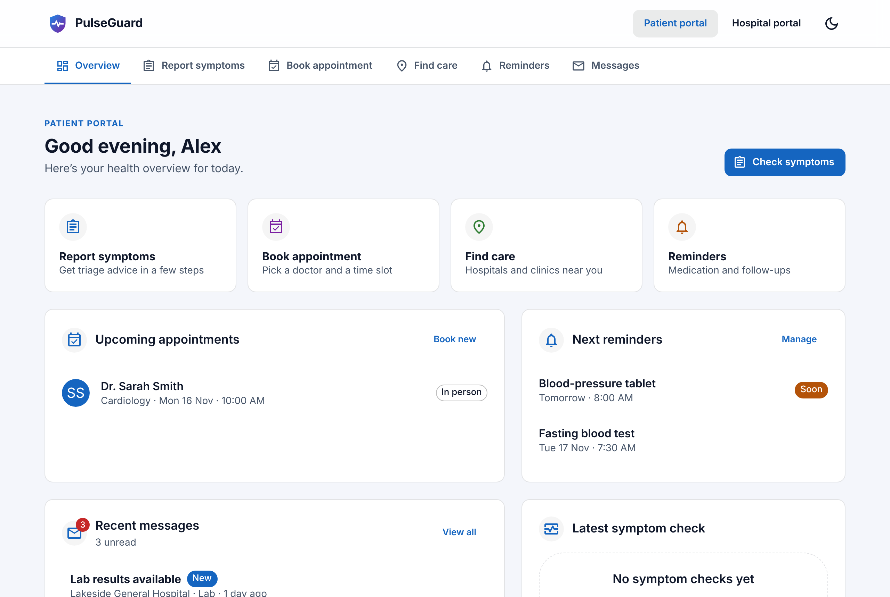

## Overview

When people feel unwell they often don't know whether to rest at home, book a GP visit or go straight to an emergency department — and hospitals only learn about demand once patients arrive. PulseGuard is a front-end prototype that connects both sides:

- **Patients** get a guided symptom checker with rule-based triage advice, a searchable map of nearby facilities, appointment booking and medication/follow-up reminders.
- **Hospital teams** see those symptom reports arrive in a prioritised triage queue alongside bed occupancy, staff rosters, crisis alerts and the appointment schedule.

It is intended as a **portfolio / demo project**. There is no backend: all data is simulated and persisted in the browser's `localStorage`, so the patient and hospital portals share state inside one browser (submit a symptom report as a patient, then open the hospital portal to see it in the queue).

> ⚠️ **Not a medical device.** The triage rules are illustrative thresholds written for the demo, not clinical guidance.

## Screenshots

All screenshots were captured from the running app with the built-in demo data.

| Home                                    | Symptom triage result                                         |
| --------------------------------------- | ------------------------------------------------------------- |
| 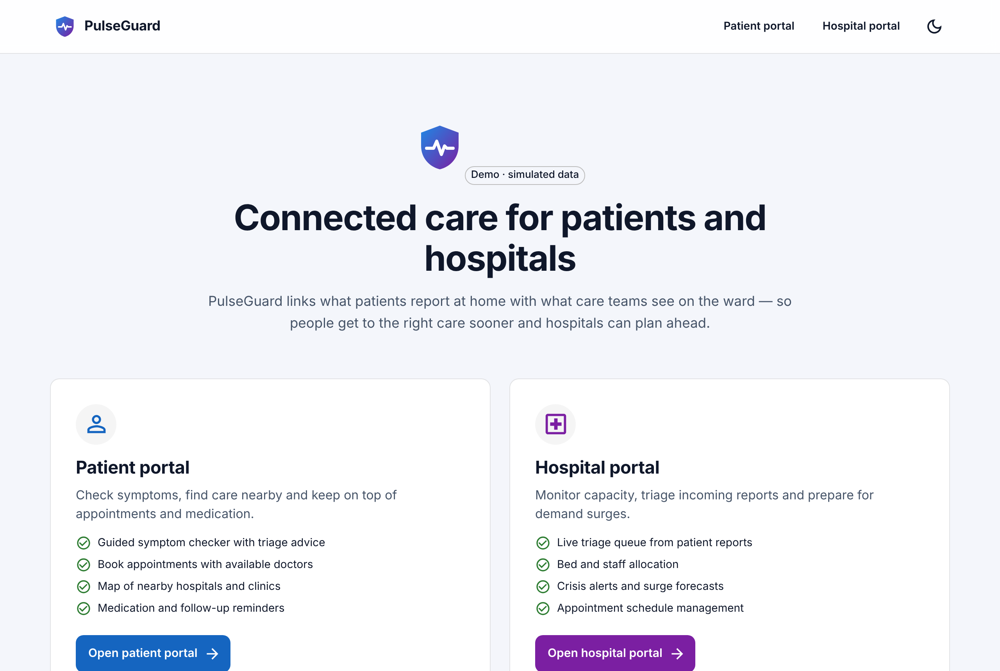 | 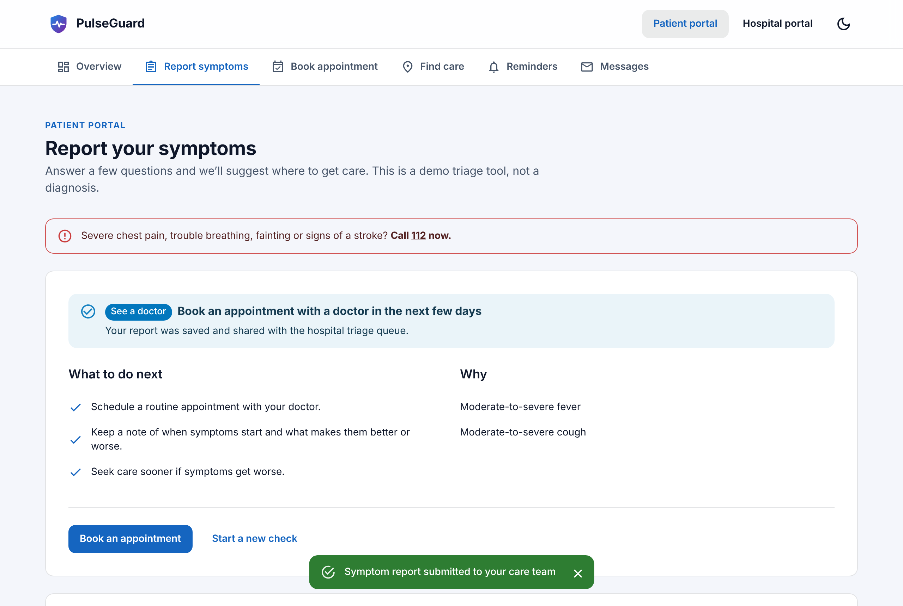 |

| Appointment booking                                  | Reminders                                    |
| ---------------------------------------------------- | -------------------------------------------- |
| 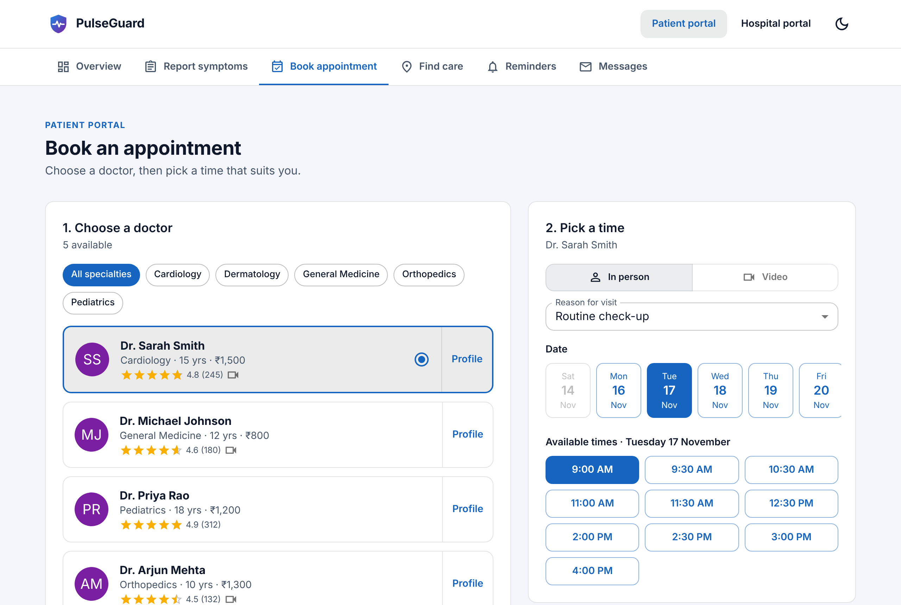 | 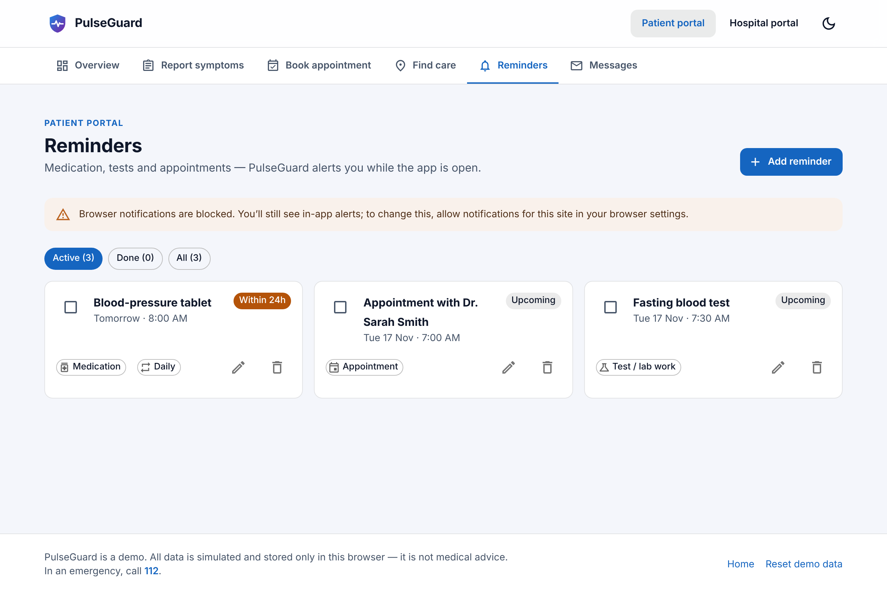 |

| Hospital overview & triage queue                              | Crisis prediction                                          |
| ------------------------------------------------------------- | ---------------------------------------------------------- |
| 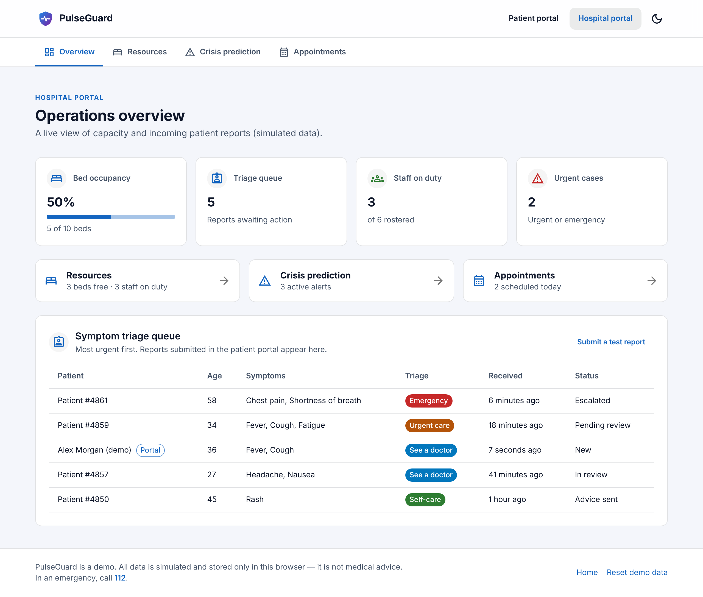 | 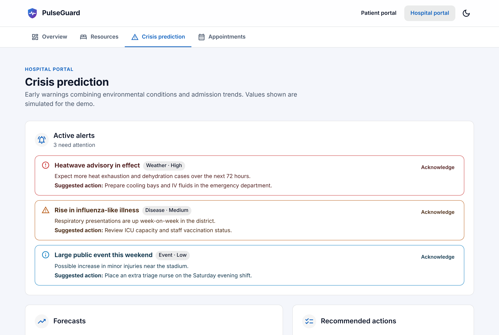 |

| Resource allocation                                             | Appointment scheduling                                                |
| --------------------------------------------------------------- | --------------------------------------------------------------------- |
| 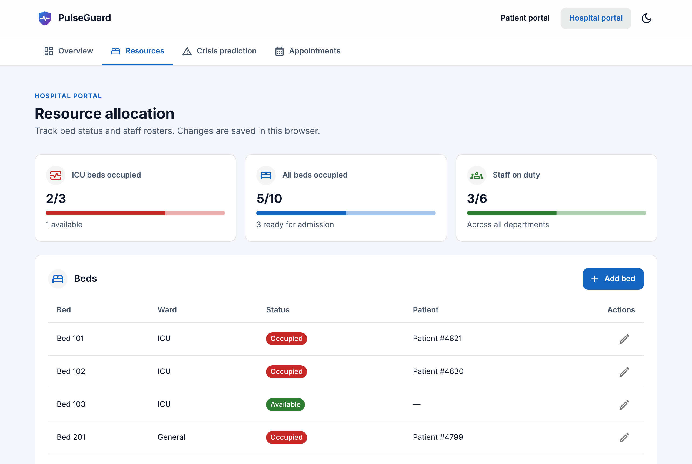 | 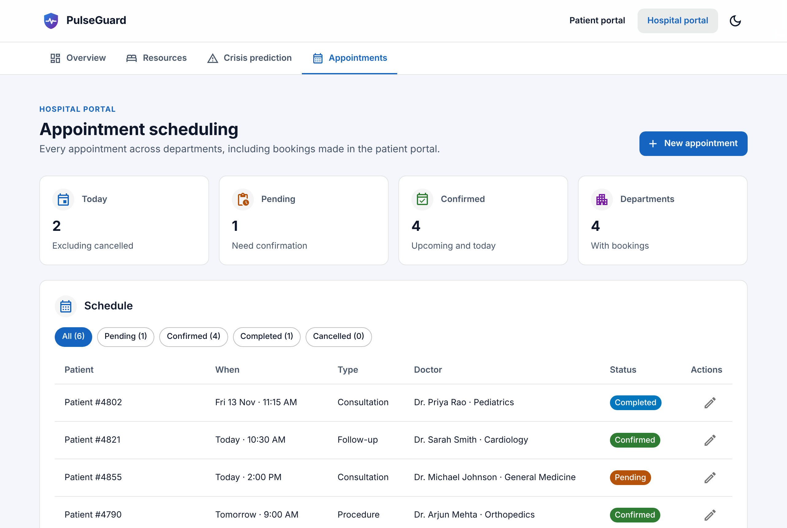 |

| Dark mode                                                 | Phone (375 px)                                       | Phone navigation                                |
| --------------------------------------------------------- | ---------------------------------------------------- | ----------------------------------------------- |
| 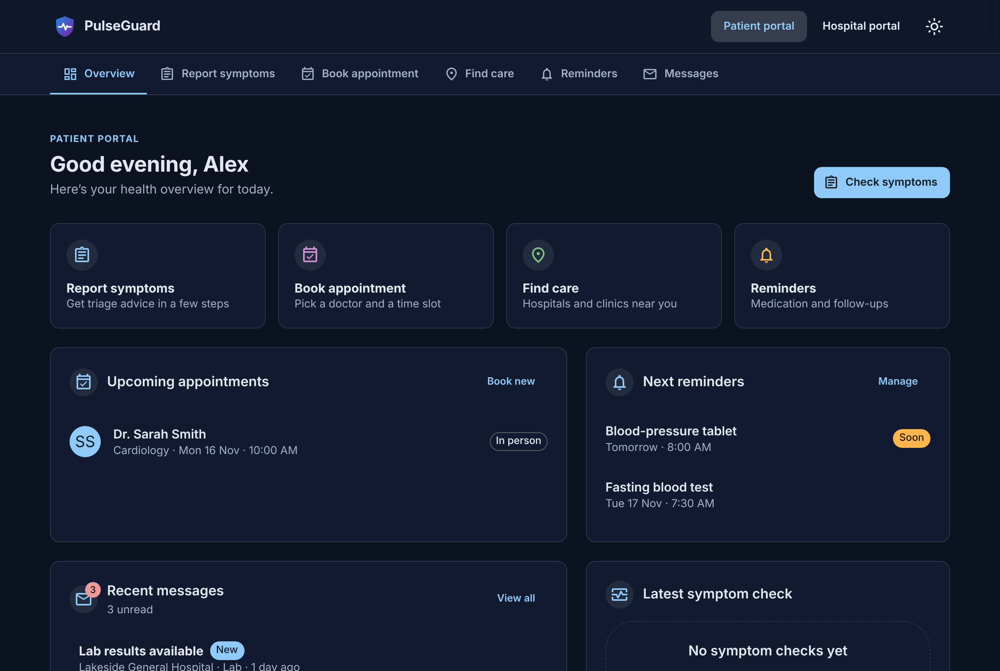 | 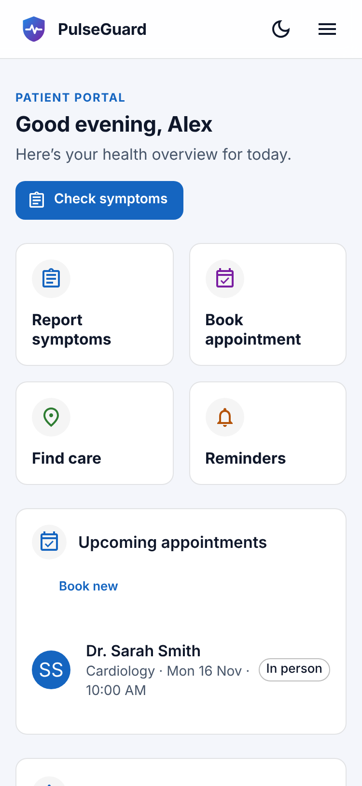 | 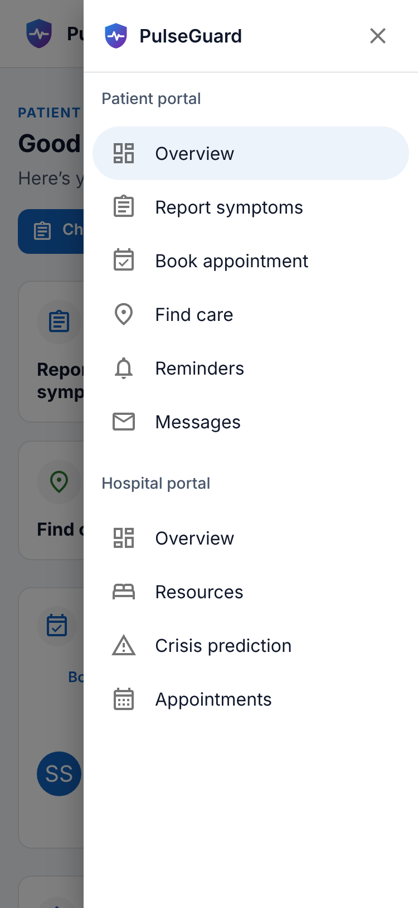 |

Facility search (map tiles were blocked in the sandbox the screenshot was taken in, so only the markers render here; with normal internet access the OpenStreetMap tiles load):

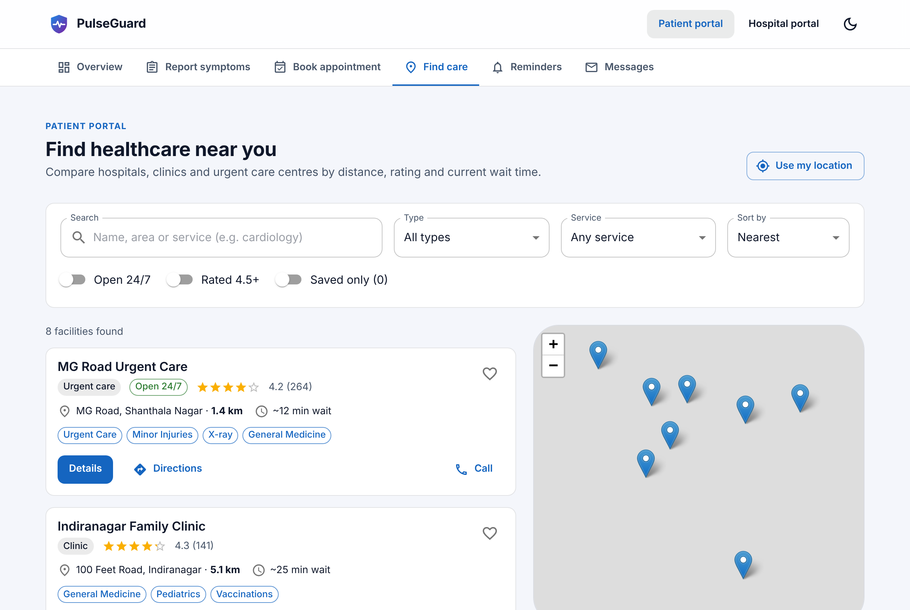

## Features

### Patient portal (`/patient`)

- **Overview** — upcoming appointments, next reminders, unread messages, latest triage result, insurance summary (editable, validated) and call/text support links.
- **Symptom checker** — 4-step wizard: pick symptoms (with "often reported together" suggestions), rate severity 1–10 and duration, add optional details (timing patterns, body areas, triggers, medicines, notes), review and submit. Produces a triage level — _self-care_, _see a doctor_, _urgent care_ or _emergency_ — with reasons and next steps, saves it to history and shares it with the hospital queue.
- **Find care** — search 8 demo facilities in Bengaluru by name/area/service, filter by type, service, 24/7 opening, rating and saved favourites, sort by distance/rating/wait/name. Interactive Leaflet map (lazy-loaded), optional "use my location" for real distances, OpenStreetMap directions links, call buttons and a details dialog that links into booking.
- **Book appointment** — filter doctors by specialty, view profiles, choose in-person or video, reason, day and a 30-minute slot. Availability is deterministic per doctor/day, past and already-booked slots are excluded, and confirming can add a reminder 2 hours before.
- **Reminders** — create/edit/delete (with undo) medication, test and appointment reminders; daily/weekly/monthly repeats; active/done filters; in-app toasts and opt-in browser notifications while the app is open.
- **Messages** — search, filter by type, sort, expand to read; unread state persists.

### Hospital portal (`/hospital`)

- **Overview** — bed occupancy, triage queue size, staff on duty, urgent cases, shortcuts, and the triage queue sorted by urgency (patient-portal reports are tagged "Portal").
- **Resources** — ICU/overall bed utilisation computed from the bed list; add/edit/remove beds and staff with validation (unique bed numbers, occupied beds need a patient reference).
- **Crisis prediction** — active alerts you can acknowledge (with undo), surge forecasts, recommended actions and environmental conditions (simulated values).
- **Appointments** — combined schedule of hospital and patient-booked appointments, status filters, create/edit dialog with validation; status changes on patient bookings flow back to the patient portal.

### Across the app

- Consistent design system (8 px spacing scale, typography hierarchy, AA-contrast palette) with **light/dark mode** that follows the OS and can be toggled.
- Responsive from 375 px phones to desktops; tables turn into cards on phones.
- Accessibility: semantic landmarks, skip link, focus moved to `<main>` on navigation, visible focus rings, labelled controls, `aria-pressed`/radio semantics for chip and slot pickers, `prefers-reduced-motion` support.
- Loading (route-level code splitting), empty, error (error boundary) and success (toasts) states; 404 page; per-page `<title>`; meta description, Open Graph image, favicon and web manifest.
- "Reset demo data" in the footer restores the seed data.

## Tech stack

| Area                        | Choice                                                                                                    |
| --------------------------- | --------------------------------------------------------------------------------------------------------- |
| UI framework                | [React 19](https://react.dev/)                                                                            |
| Component library / styling | [Material UI 7](https://mui.com/material-ui/) + Emotion                                                   |
| Routing                     | [React Router 7](https://reactrouter.com/) (`BrowserRouter`, nested routes, `React.lazy` code splitting)  |
| Maps                        | [Leaflet](https://leafletjs.com/) + [react-leaflet 5](https://react-leaflet.js.org/), OpenStreetMap tiles |
| Dates                       | [date-fns 4](https://date-fns.org/)                                                                       |
| Build tooling               | [Create React App 5](https://create-react-app.dev/) (`react-scripts`)                                     |
| Testing                     | Jest (via react-scripts) + [React Testing Library](https://testing-library.com/) + user-event             |
| Lint / format               | ESLint (`react-app` config incl. jsx-a11y and hooks rules) + Prettier                                     |
| Persistence                 | Browser `localStorage` (no backend)                                                                       |

## Architecture

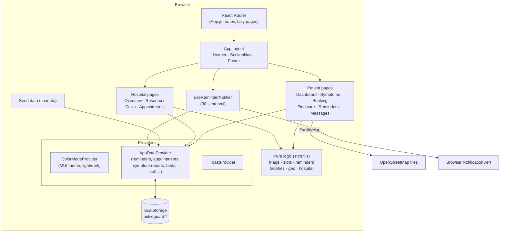

Key design decisions:

- **Pure logic is separated from UI.** Triage rules, slot generation, reminder scheduling, facility search and hospital summaries live in `src/utils` as side-effect-free functions with unit tests.
- **One client-side store.** `AppDataProvider` holds every persisted slice using a `usePersistentState` hook, so both portals read and write the same data and the reminder notifier never fights a page over stale copies.
- **Heavy parts load on demand.** Every page except the home page is a lazy chunk, and Leaflet is only fetched when the facility search page renders its map.

## Project structure

```text
pulseguard/
├── public/                    # index.html (meta/OG tags), favicon.svg/.ico, icons, manifest, og-image
├── docs/screenshots/          # README screenshots captured from the running app
├── src/
│   ├── App.js                 # Providers + route table (lazy-loaded pages)
│   ├── index.js               # React entry point
│   ├── index.css              # Global focus ring + Leaflet overrides
│   ├── config.js              # REACT_APP_* environment configuration
│   ├── theme/                 # Design system (buildTheme) and light/dark ColorModeProvider
│   ├── state/                 # AppDataProvider (persisted demo data) and ToastProvider
│   ├── hooks/                 # usePersistentState, usePageTitle, useReminderNotifier
│   ├── data/                  # Seed data: symptoms, doctors, facilities, patient, hospital
│   ├── utils/                 # Pure logic: triage, slots, reminders, facilities, geo, format…
│   │   └── __tests__/         # Unit tests for the logic above
│   ├── components/
│   │   ├── layout/            # AppLayout, Header (+ mobile drawer), SectionNav, Footer, navigation config
│   │   ├── common/            # PageHeader, SectionCard, StatCard, ResponsiveTable, EmptyState, …
│   │   ├── map/               # FacilityMap (Leaflet, lazy-loaded)
│   │   └── patient/           # InsuranceCard
│   ├── pages/
│   │   ├── HomePage.js, NotFoundPage.js
│   │   ├── patient/           # PatientDashboard, SymptomReport, AppointmentBooking, FacilitySearch, Reminders, Messages
│   │   └── hospital/          # HospitalDashboard, ResourceAllocation, CrisisPrediction, AppointmentScheduling
│   ├── test/renderApp.js      # Test helper rendering the app in a MemoryRouter
│   ├── __tests__/             # Integration tests (routing and main user flows)
│   └── setupTests.js          # jest-dom + jsdom polyfills
├── .env.example               # Documented configuration variables
├── .prettierrc.json / .prettierignore
├── .nvmrc                     # Node version used for development (22)
└── package.json
```

## Getting started

### Prerequisites

- **Node.js 18 or newer** (developed and verified on Node 22; see `.nvmrc`)
- **npm 9+** (ships with Node)

### Installation

```bash
git clone https://github.com/jeevithg090/pulseguard.git
cd pulseguard
npm ci            # installs the exact versions from package-lock.json
cp .env.example .env.local   # optional — every variable has a default
npm start         # http://localhost:3000
```

### Configuration

All variables are optional and are read at **build time** by Create React App. They are embedded in the public JavaScript bundle, so never put secrets in them.

| Variable                     | Required | Default                                              | Description                                                                       |
| ---------------------------- | -------- | ---------------------------------------------------- | --------------------------------------------------------------------------------- |
| `REACT_APP_SUPPORT_PHONE`    | No       | `+1-555-0100`                                        | Number used by the "Call support" (`tel:`) and "Text support" (`sms:`) buttons.   |
| `REACT_APP_EMERGENCY_NUMBER` | No       | `112`                                                | Emergency number shown in triage results, the symptom page banner and the footer. |
| `REACT_APP_MAP_TILE_URL`     | No       | `https://{s}.tile.openstreetmap.org/{z}/{x}/{y}.png` | XYZ tile template for the facility map.                                           |
| `REACT_APP_MAP_ATTRIBUTION`  | No       | OpenStreetMap contributors link                      | Attribution HTML shown on the map.                                                |

For production traffic, use a tile provider that permits your usage — the public OpenStreetMap tile servers have a [usage policy](https://operations.osmfoundation.org/policies/tiles/).

### Running

| Mode              | Command              | Notes                                           |
| ----------------- | -------------------- | ----------------------------------------------- |
| Development       | `npm start`          | Hot reload on http://localhost:3000             |
| Production build  | `npm run build`      | Optimised, hashed assets in `build/`            |
| Preview the build | `npx serve -s build` | `-s` serves `index.html` for client-side routes |

## Usage walkthrough

1. Open **Patient portal → Report symptoms**, pick e.g. _Chest pain_ and _Shortness of breath_, raise both severities to 6 and submit — the result is **Emergency** with a call button. Milder inputs give _self-care_ or _see a doctor_ advice.
2. Open **Hospital portal → Overview**: your report is at the top of the triage queue, tagged _Portal_.
3. **Book appointment**: choose a doctor, a day and a slot, confirm. It appears on the patient overview, in **Hospital → Appointments**, and (if ticked) as a reminder 2 hours earlier. Cancelling it from the hospital schedule removes it from the patient's upcoming list.
4. **Find care**: search "cardiology", toggle _Open 24/7_, save a favourite, press _Use my location_ to measure distances from where you are.
5. **Reminders**: add one a minute or two in the future; when it is due you'll get an in-app toast (and a browser notification if you enabled them).
6. Use the moon/sun button for dark mode, and **Reset demo data** in the footer to start over.

### Triage rules (summary)

Implemented in [`src/utils/triage.js`](src/utils/triage.js) with thresholds per symptom in [`src/data/symptoms.js`](src/data/symptoms.js):

| Level        | When                                                                                                                            |
| ------------ | ------------------------------------------------------------------------------------------------------------------------------- |
| Emergency    | A red-flag symptom (chest pain, shortness of breath) rated ≥ 7, or chest pain **and** shortness of breath both ≥ 5              |
| Urgent care  | Severity ≥ the symptom's urgent threshold, a red-flag symptom ≥ 4, a duration beyond the urgent limit, or 3+ symptoms rated ≥ 6 |
| See a doctor | Severity ≥ 5 or a duration beyond the review limit                                                                              |
| Self-care    | Everything else                                                                                                                 |

## Routes

PulseGuard has no backend API; these are the client-side routes.

| Path                        | Page                                                     |
| --------------------------- | -------------------------------------------------------- |
| `/`                         | Home — choose a portal                                   |
| `/patient`                  | Patient overview                                         |
| `/patient/symptoms`         | Symptom checker                                          |
| `/patient/book-appointment` | Booking (`?facility=<id>` or `?doctor=<id>` preselects)  |
| `/patient/facilities`       | Find care (`?type=urgent-care` etc. preselects the type) |
| `/patient/care-navigation`  | Redirects to `/patient/facilities` (legacy URL)          |
| `/patient/reminders`        | Reminders                                                |
| `/patient/messages`         | Messages (`?open=<message-id>` expands one)              |
| `/hospital`                 | Hospital overview and triage queue                       |
| `/hospital/resources`       | Beds and staff                                           |
| `/hospital/crisis`          | Alerts and forecasts                                     |
| `/hospital/appointments`    | Appointment schedule                                     |
| `*`                         | 404 page                                                 |

## Scripts

| Script                 | What it does                                  |
| ---------------------- | --------------------------------------------- |
| `npm start`            | Start the dev server                          |
| `npm run build`        | Production build into `build/`                |
| `npm test`             | Jest in interactive watch mode                |
| `npm run test:ci`      | Run all tests once (non-interactive)          |
| `npm run lint`         | ESLint over `src/` with zero warnings allowed |
| `npm run format`       | Format sources with Prettier                  |
| `npm run format:check` | Check formatting without writing              |

## Testing

```bash
npm run test:ci
```

53 tests across 6 suites:

- **Unit tests** (`src/utils/__tests__`) — triage levels, combinations and suggestions; reminder repeat scheduling, status, validation and due-reminder collection; deterministic slot generation (lunch break, Saturdays, past/booked slots); facility filtering/sorting and haversine distance; storage fallbacks, formatting, bed summaries, triage-queue merging and navigation matching.
- **Integration tests** (`src/__tests__/app.test.js`) — rendering the full app with providers in a `MemoryRouter`: home page, 404, legacy redirect, dark-mode toggle, the full symptom flow (validation → emergency result → report visible in the hospital queue), adding a reminder with validation, and booking an appointment that then appears on the patient dashboard. The Leaflet map is mocked in tests.

## Linting and formatting

ESLint uses CRA's `react-app` configuration (React, hooks and jsx-a11y rules) plus `eslint-config-prettier`; Prettier handles formatting (`.prettierrc.json`: single quotes, 100-column lines, trailing commas).

```bash
npm run lint
npm run format:check
```

## Deployment

The output of `npm run build` is a static site, so any static host works (Netlify, Vercel, GitHub Pages, S3 + CloudFront, Nginx…). Two things to configure:

1. **SPA fallback** — the app uses `BrowserRouter`, so unknown paths must serve `index.html`:
   - Netlify: add `public/_redirects` containing `/*  /index.html  200`
   - Vercel: a rewrite of `/(.*)` to `/index.html`
   - Nginx: `try_files $uri /index.html;`
2. **Sub-path hosting** — when serving from a sub-directory (e.g. GitHub Pages project sites), set `"homepage"` in `package.json`; the router's `basename` follows `PUBLIC_URL` automatically.

Set any `REACT_APP_*` variables in the host's build environment, since they are inlined at build time.

## Troubleshooting / FAQ

- **The map is grey / has no streets.** The tile server is unreachable (offline, firewall, or blocked by a privacy extension). Markers and the list still work; set `REACT_APP_MAP_TILE_URL` to another provider if needed.
- **"Use my location" says permission was denied.** Allow location for the site in your browser. Geolocation also requires HTTPS (or `localhost`). Distances fall back to Bengaluru city centre.
- **I never get browser notifications.** Click _Enable_ on the Reminders page; if the browser shows "blocked", re-allow notifications in site settings. Reminders only fire while a PulseGuard tab is open (there is no service worker or server).
- **My data disappeared.** Everything lives in `localStorage` for the current browser profile; private windows and clearing site data wipe it. Use _Reset demo data_ to restore the seed data deliberately.
- **Refreshing a page on my host gives a 404.** Configure the SPA fallback described under [Deployment](#deployment).
- **`npm install` prints deprecation and audit warnings.** They come from Create React App's build tooling (`react-scripts`), which is a dev dependency and not shipped to users. `npm audit --omit=dev` reports 0 vulnerabilities for the runtime dependencies.

## Known limitations

- No backend, authentication or real patient records — data is per-browser and simulated. Do not enter real personal or health information.
- Triage is a simple rule set for demonstration, not a validated clinical algorithm.
- Facilities, doctors, wait times, alerts and forecasts are fictional static data; nothing updates in real time.
- Reminder notifications only fire while the app is open.
- Create React App is no longer actively maintained, and its dev-dependency tree carries known audit findings.

## Roadmap ideas

- Migrate the build from Create React App to Vite (faster builds, maintained tooling, clean `npm audit`).
- Add a backend (e.g. REST or GraphQL) with authentication and role-based access for patients vs. staff.
- Real-time updates for the triage queue (WebSockets / server-sent events).
- Push notifications via a service worker so reminders work with the app closed.
- Internationalisation and localised emergency numbers.
- End-to-end tests (Playwright) and visual regression checks.

## Contributing

1. Fork and create a feature branch.
2. `npm ci`, then make your change with tests where it touches logic in `src/utils`.
3. Make sure `npm run lint`, `npm run format:check`, `npm run test:ci` and `npm run build` all pass.
4. Use [Conventional Commits](https://www.conventionalcommits.org/) (`feat:`, `fix:`, `docs:` …) and open a pull request describing the change and how you verified it.

## License

No license has been chosen yet, which means all rights are reserved by default. If you want others to use or contribute to the code, consider adding an open-source license such as [MIT](https://choosealicense.com/licenses/mit/).
